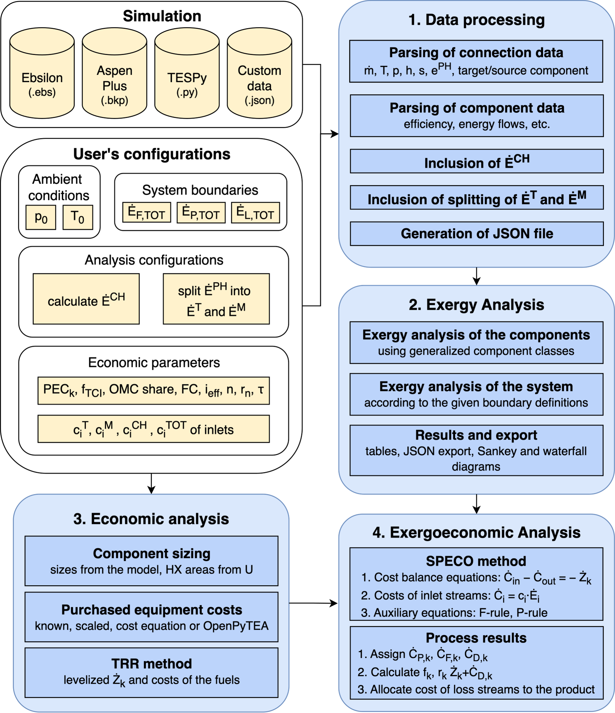

# Summary

Exergy is the maximum theoretical useful work obtainable from a system as it is brought into complete thermodynamic equilibrium with its environment while interacting with this environment only [@bejan1996thermal]. In contrast to energy, exergy is not conserved but destroyed in every real process, so an exergy analysis identifies the location and the magnitude of the thermodynamic inefficiencies of a system [@bejan1996thermal]. ExerPy is an open-source Python framework that automates such analyses for thermodynamic systems. It is coupled with the process-simulation software Aspen Plus®, Ebsilon®Professional and TESPy through a unified JSON interface. ExerPy automatically identifies the components of a system, formulates their exergy balances and evaluates key performance indicators such as the exergy destruction and the exergetic efficiency. By accounting for both physical and chemical exergy and minimizing manual calculations, ExerPy enables consistent second-law analyses of a wide range of systems, from simple thermodynamic cycles to complex plants. Its standardized outputs facilitate the comparison of analyses across different simulation tools and their subsequent processing. Building on the results of the exergy analysis, ExerPy further conducts economic and exergoeconomic analyses, which determine the cost rates associated with the components, the exergy streams and the exergy destruction.

# Statement of need

Exergy analysis is an effective tool for assessing the quality of energy and its capability to generate useful work: in contrast to an energy balance, it values each energy flow by this capability [@bejan1996thermal; @Tsatsaronis_1993]. It facilitates the identification of thermodynamic irreversibilities within a system and attributes them to its individual components, thereby offering a more comprehensive understanding of energy conversion processes [@Tsatsaronis_1993]. The quantification of exergy destruction enables researchers and engineers to develop strategies that enhance efficiency, reduce costs, and promote sustainable conversion technologies [@Tsatsaronis_1993; @Meyer_2008; @petrakopoulou2017improving].

Despite these advantages, in most simulation tools the application of exergy analysis still relies heavily on user input, since the definitions of the exergy of the fuel and the exergy of the product must be derived and implemented manually for each component [@Witte_2022]. This procedure is laborious [@Hofmann2022] and prone to misinterpretations of the component balances [@tsatsaronis2024future]. ExerPy addresses this need by automating the exergy analysis of energy conversion systems in Python through a JSON data interface. Its application programming interface connects to different process-simulation environments, identifies the components and assigns their exergy balances automatically, which enables a detailed and accurate exergy analysis of the entire process. This automation reduces the effort and improves the accuracy of applying exergy analysis, and thereby supports the optimization of energy conversion systems from an exergy perspective.

# State of the field

Automated exergy analysis remains only sparsely supported by existing thermodynamic simulation software, which primarily focuses on energy and mass balance calculations [@Witte_2022]. One of the few exceptions is the commercial software Cycle-Tempo [@cycletempo], which includes an exergy analysis but no exergoeconomic analysis. Other tools cover only parts of this workflow. The open-source MATLAB/Octave toolbox TaesLab [@torres2023taeslab] performs thermoeconomic analyses, but requires the exergy values of all flows and the definitions of fuel and product of all components as input. Commercial simulators such as Aspen Plus® and Ebsilon®Professional report the exergy of streams but leave the formulation of the component exergy balances to the user. Within the open-source landscape, Zoder et al. [@Zoder_2018] demonstrated the simulation and exergy analysis of a combined cycle gas turbine with a Python-based framework. Subsequently, the calculation of the physical and chemical exergy of material streams, as well as an automated evaluation of the overall process, was integrated into the simulation framework TESPy [@Witte_2020; @Witte_2022; @Hofmann2022]. However, this functionality is coupled to TESPy's data model and therefore limited to models created within TESPy, while extending it to process results from commercial tools would increase complexity, dependencies, and maintenance requirements for users primarily interested in simulation. To the best of the authors' knowledge, no other open-source package performs automated exergy analysis based on the results of commercial process-simulation software. A dedicated package was therefore required to provide a single, maintainable, open-source framework that performs automated exergy analysis across both commercial and open-source tools, including user-supplied system data via JSON.

# Software design

ExerPy has been developed as an exergy-analysis tool that is independent of any specific process-simulation environment. A central architectural decision was to separate data acquisition and normalization from the exergy-calculation core. Simulation-specific adapters extract stream and component information from Aspen Plus®, Ebsilon®Professional, or TESPy and convert it into a standardized JSON representation. The analysis module operates exclusively on this uniform component- and connection-based schema, which enables consistent component- and system-level balances and standardized outputs.

# Features

ExerPy comprises four modules (\autoref{fig:structure}): a data-processing module, which manages the extraction and preparation of simulation data; an exergy-analysis module, which conducts the detailed exergy calculations; and an economic and an exergoeconomic module, which build on the results of the exergy analysis. Simulation data are read from Ebsilon®Professional, Aspen Plus®, and TESPy, or from a user-supplied JSON file. The first two modules are described in the following sections, whereas the economic and exergoeconomic modules are documented online [@exerpy-web].

{width="80%"}

## Data processing

An analysis begins with the parsing of the simulation results of models created in Ebsilon®Professional, Aspen Plus®, or TESPy by the functions `from_ebsilon`, `from_aspen`, and `from_tespy`, respectively. The physical exergy of the streams, calculated from their enthalpy and entropy, is obtained directly from the simulation tools. Independently of the simulation software, users may also supply their own JSON file via `from_json`, which must conform to the input format of ExerPy. Before the analysis, all input data, whether parsed or supplied by the user, are validated against a JSON schema. Values may be specified together with their units, which ExerPy converts to SI units.

During parsing, connection data such as the mass flow rate ($m$), temperature ($T$), pressure ($p$), enthalpy ($h$), entropy ($s$), and physical exergy ($e^\text{PH}$) are extracted together with the source and target component of each connection. In addition, component data such as efficiencies, energy flows, and other relevant thermodynamic properties are extracted. The ambient conditions are either taken from the simulation or specified by the user.

ExerPy also allows the splitting of physical exergy into thermal ($e^\text{T}$) and mechanical ($e^\text{M}$) parts. Considering these parts separately improves the accuracy of exergy-based evaluations and supports their application in optimization, particularly for streams below the ambient temperature [@morosuk2019splitting]. Both parts are calculated with the native property functions of the respective simulation tool.

After the data have been parsed, the chemical exergy of each stream is calculated from its composition, following the approach of TESPy [@Hofmann2022] and the reference environment developed by Ahrendts [@Ahrendts_1977]. Each pure substance is assigned the tabulated standard chemical exergy of this reference environment, whereas the chemical exergy of a gas mixture is derived from its molar composition under the assumption of ideal mixing, with water that condenses at ambient conditions treated as a separate liquid phase [@Hofmann2022]. Finally, all parsed and calculated data are consolidated into a standardized JSON file that is independent of the simulation tool and contains all information required for a comprehensive exergy analysis.

## Exergy analysis

The framework performs exergy analysis at both the component and system levels. Each component of the system—such as turbines, compressors, and heat exchangers—is represented by a Python class that automatically assigns the exergy of the fuel and the exergy of the product of the component. These definitions build on those of Witte et al. [@Witte_2022], which are formulated with the split physical exergy. ExerPy additionally provides definitions for the unsplit physical exergy and, following the SPECO method [@lazzaretto2006speco], for chemical exergy, mixing and combustion processes. Using these definitions, ExerPy calculates relevant metrics for each component (i.e., the exergy destruction and exergetic efficiency). Thermal energy losses of components are included in their exergy destruction, and streams discharged to the environment are treated as exergy losses of the overall system. This approach provides coherent calculations of the inefficiencies of individual components and supports targeted optimization.

At the system level, the total exergy balance is established by evaluating the exergy of streams crossing the system boundaries. To perform this analysis, and in the current release of the tool, it is necessary for the user to specify the product, the fuel, and the exergy loss of the overall process. The system-level exergy analysis yields the overall exergetic efficiency and the total exergy destruction of the overall system. Finally, the results are returned as pandas DataFrames and can be exported to JSON or, via pandas, to CSV for further examination and integration into additional workflows. In addition, ExerPy generates Sankey and waterfall diagrams of the exergy flows [@exerpy-web].

## Validation

The framework has been validated with three case studies documented in its online documentation [@exerpy-web]: a combined cycle power plant, the CGAM problem [@valero1994cgam], and a heat pump. Each system was modeled in Ebsilon®Professional, Aspen Plus®, and TESPy, and the results of all three models were analyzed with ExerPy. The exergy destruction of each component (or group of components, where the simulators divide the plant differently) deviates by at most 0.6% from the results based on Ebsilon®Professional, and the overall exergetic efficiencies agree within 0.1 percentage points. The comparisons are provided as Jupyter notebooks in the GitHub repository.

# Research impact statement

The demand for automated, publicly accessible exergy-analysis workflows is evidenced by the prior adoption of TESPy's exergy-analysis functionality in educational [@hofmann2023free] and applied studies [@hofmann2024exergy; @fritzopen]. Beyond these individual studies, the automation of exergy-based methods in software has been identified as a means to broaden their application in research and industrial practice [@tsatsaronis2024future].

ExerPy addresses this demand with a dedicated, versioned, and openly developed package within the oemof ecosystem. It has already been applied to the exergoeconomic analysis and design optimization of high-temperature heat pumps [@tomasinelli2025ecos; @tomasinelli2026ecos], used in the heatpumps model library and web dashboard [@heatpumps], and employed in several student theses. ExerPy is distributed under the MIT license and maintained in a public repository with continuous integration testing on all supported Python versions, complemented by documentation that provides executable examples and contribution guidelines to support reproducible analyses and adoption by the research community.

# AI usage disclosure

Generative AI tools were used during development: ChatGPT (GPT-4, GPT-5, GPT-5.1, GPT-5.2, GPT-5.4) and Claude Code (Opus 4.5, Opus 4.6, Opus 4.7, Opus 4.8, Opus 5.5, Fable 5.1) for code generation, refactoring, and test scaffolding in the codebase and for drafting parts of the documentation; Claude (Opus 4.6, Opus 4.7, Opus 4.8, Opus 5.5, Fable 5.1) and DeepL Write for copy-editing of this manuscript. All AI-assisted output was reviewed, edited, and validated by the authors, who made all core design and architectural decisions, including the simulator-independent JSON data format and the component-based analysis structure.

# Acknowledgements

Parts of this work were funded by the German Federal Ministry for Economic Affairs and Climate Action (BMWK) through the research project SecöndLife, grant numbers 03EI1076A (DLR) and 03EI1076B (TUB). The funding agency had no involvement in the design, development, or preparation of this work.

# References
